<p align="center">
  
</p>

<p align="center">
  <a href="https://itch.io/jam/game-off-2026"></a>
  
  
  
  
</p>

<p align="center">
  <b>Every layer comes out of the nozzle misaligned.</b><br />
  Shift it back into place before it hits the plate, using nothing but the two <kbd>Shift</kbd> keys.
</p>

---

## 🔀 Four kinds of SHIFT

| | |
|---|---|
| 🖨️ **Layer shift** | The 3D printing failure where layers slide out of place. Here, you fix it live. |
| ⌨️ **Shift keys** | The whole game is played with <kbd>Left Shift</kbd> and <kbd>Right Shift</kbd>. |
| 🔢 **Bit shift** | Each layer is a row of filament bits. Shift it left or right; bits pushed past the edge are gone for good. |
| 🌙 **Night shift** | The print queue runs from 22:00 to 06:00. Finish before sunrise. |

## 🎮 How to play

| Key | Action |
|:---:|---|
| <kbd>⇧ Left Shift</kbd> | shift the layer left |
| <kbd>Right Shift ⇧</kbd> | shift the layer right |
| <kbd>⇧</kbd> + <kbd>⇧</kbd> | both at once: drop the layer now |
| <kbd>P</kbd> / <kbd>Esc</kbd> | pause: resume, restart the job or the whole night |
| <kbd>M</kbd> | sound on / off |
| 📱 Touch | tap the left / right half of the screen, two fingers to drop |

Match each layer with the **blueprint** on the right before the timer runs out.

- 🍝 Filament printed over air sags into **spaghetti**.
- 🟥 Filament in the wrong place turns **red**.
- ✨ Clean layers in a row build a **combo**.
- 🚀 Print the last job clean and see what happens.

## 🛠️ Built with

<p>
  
  
  
  
  
</p>

- **Zero asset files.** Every graphic is drawn in code, every sound and the chiptune soundtrack are synthesized with WebAudio.
- **Tested headless.** A bot plays every job, and regression tests cover pause and the Shift-key chord.

```bash
npm install
npm run build    # dist/ + dist/game-web.zip (itch.io HTML upload)
npm run single   # dist/layer-shift.html: the whole game in one file
npm test         # smoke, stuck-Shift and pause tests
npm run play     # headless playthrough of all jobs
```

## 👤 Credits

Made by **Emanuele Esposito** · [Emanuele Tech](https://www.instagram.com/emanuele_tech).

Fonts: [Poppins](https://github.com/itfoundry/Poppins) (SIL OFL 1.1) and DejaVu Sans Mono (Bitstream Vera license); licenses in `public/fonts/`.

## 📄 License

Code: MIT. Fonts: see their licenses in `public/fonts/`.
