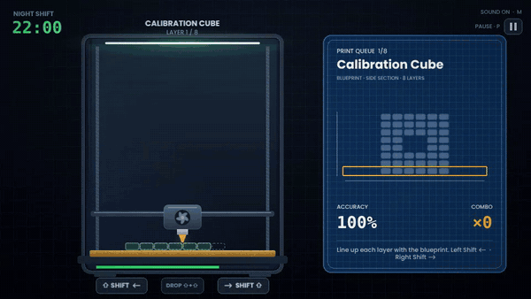
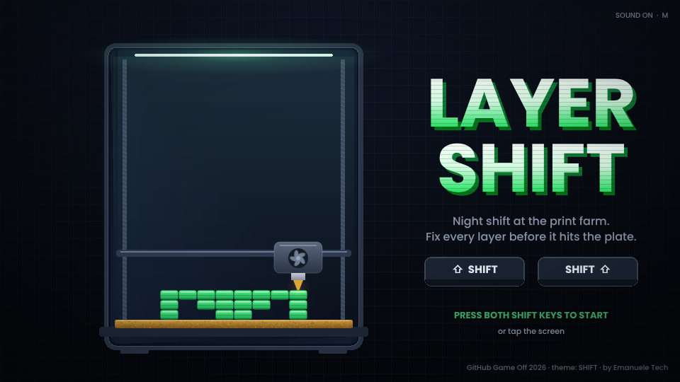
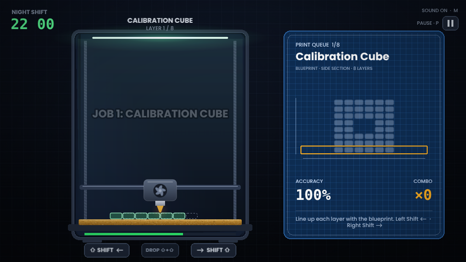
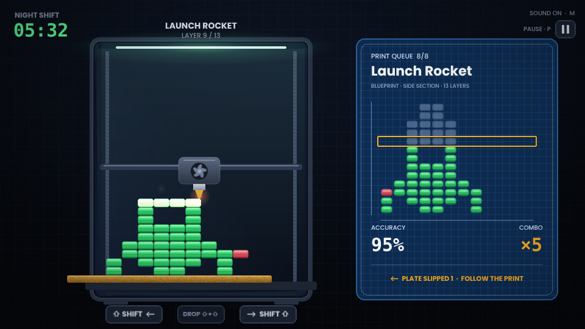
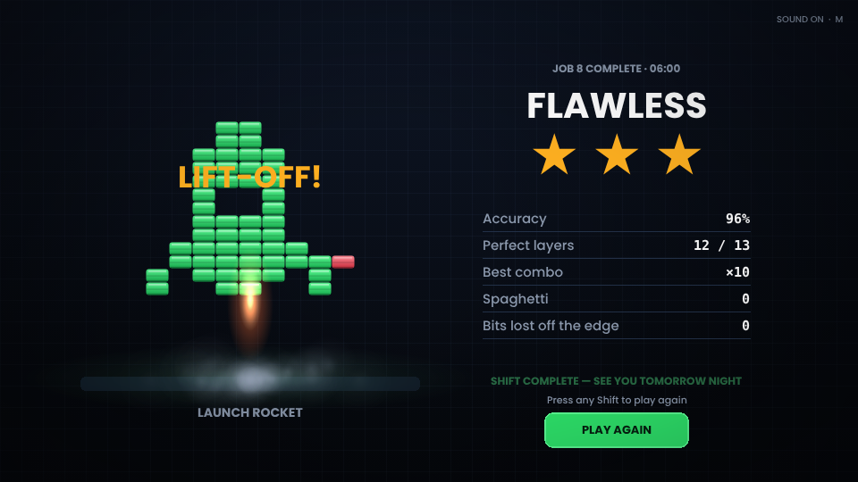

<p align="center">
  
</p>

<p align="center">
  <a href="https://itch.io/jam/game-off-2026"></a>
  
  
  
  
</p>

<p align="center">
  <b>Every layer comes out of the nozzle misaligned.</b><br />
  Shift it back into place before it hits the plate, using nothing but the two <kbd>Shift</kbd> keys.
</p>

<p align="center">
  <a href="https://emanueletech.github.io/layer-shift/"></a>
  <a href="https://emanueletech.itch.io/layer-shift"></a>
</p>

<p align="center">
  
</p>

---

## 🔀 Four kinds of SHIFT

| | |
|---|---|
| 🖨️ **Layer shift** | The 3D printing failure where layers slide out of place. Here, you fix it live. |
| ⌨️ **Shift keys** | The whole game is played with <kbd>Left Shift</kbd> and <kbd>Right Shift</kbd>. |
| 🔢 **Bit shift** | Each layer is a row of filament bits. Shift it left or right; bits pushed past the edge are gone for good. |
| 🌙 **Night shift** | Eight print jobs run from 22:00 to 06:00. Finish before sunrise. |

From job 5 the build plate is loose: mid-layer it **jolts sideways**, a real layer shift. The part already printed slides with it, so does the blueprint, and the layer in the nozzle has to chase it.

## 🎮 How to play

| Key | Action |
|:---:|---|
| <kbd>⇧ Left Shift</kbd> | shift the layer left |
| <kbd>Right Shift ⇧</kbd> | shift the layer right |
| <kbd>⇧</kbd> + <kbd>⇧</kbd> | both at once: drop the layer now |
| <kbd>P</kbd> / <kbd>Esc</kbd> | pause: resume, restart the job or the whole night |
| <kbd>M</kbd> | sound on / off |
| 📱 Touch | tap left / right of the printer (or the on-screen keys), **DROP** or two fingers to print |

Match each layer with the **blueprint** on the right before the timer runs out.

- 🍝 Filament printed over air sags into **spaghetti**.
- 🟥 Filament in the wrong place turns **red**.
- ✨ Clean layers in a row build a **combo**.
- 🫨 From job 5 the plate slips: follow the print, not the old spot.
- 🚀 Print the last job clean and see what happens.

### 🧾 The print queue

| # | Job | Layers | Twist |
|:-:|---|:-:|---|
| 1 | Calibration Cube | 8 | guide marks on the bed |
| 2 | Spiral Vase | 11 | thin walls, easy spaghetti |
| 3 | Phone Stand | 11 | a long diagonal |
| 4 | Arch Bridge | 9 | wide layers, tight margins |
| 5 | Coffee Mug | 10 | 🫨 the plate slips once |
| 6 | Chess Rook | 11 | 🫨 once, faster |
| 7 | Zigzag Spring | 12 | 🫨 twice, long throws |
| 8 | Launch Rocket | 13 | 🫨 twice, and it might fly |

## 📸 Screenshots

<p>
  
  
  
  
</p>

## 🌐 Play online

- **GitHub Pages:** <https://emanueletech.github.io/layer-shift/>, rebuilt on every push to `main` by `.github/workflows/pages.yml`.
- **itch.io:** <https://emanueletech.itch.io/layer-shift>, the jam entry for GitHub Game Off 2026.

Works on desktop browsers and on phones in landscape.

## 🛠️ Built with

<p>
  
  
  
  
  
</p>

- **Zero asset files.** Every graphic is drawn in code, every sound and the chiptune soundtrack are synthesized with WebAudio.
- **Tested headless.** A bot plays all eight jobs (plate shifts included), and tests cover level data, pause, touch and the Shift-key chord.

```bash
npm install
npm run build    # dist/ + dist/game-web.zip (itch.io HTML upload)
npm run single   # dist/layer-shift.html: the whole game in one file
npm test         # level data, smoke, stuck-Shift, pause and touch tests
npm run play     # headless playthrough of all eight jobs
npm run media    # re-record docs/media: gameplay GIF, screenshots, itch.io cover (ffmpeg + ImageMagick)
```

## 👤 Credits

Made by **Emanuele Esposito** · [Emanuele Tech](https://www.instagram.com/emanuele_tech).

Publishing kit (itch.io page copy, embed settings, jam checklist): [`docs/itch-page.md`](docs/itch-page.md).

Fonts: [Poppins](https://github.com/itfoundry/Poppins) (SIL OFL 1.1) and DejaVu Sans Mono (Bitstream Vera license); licenses in `public/fonts/`.

## 📄 License

Code: MIT. Fonts: see their licenses in `public/fonts/`.
